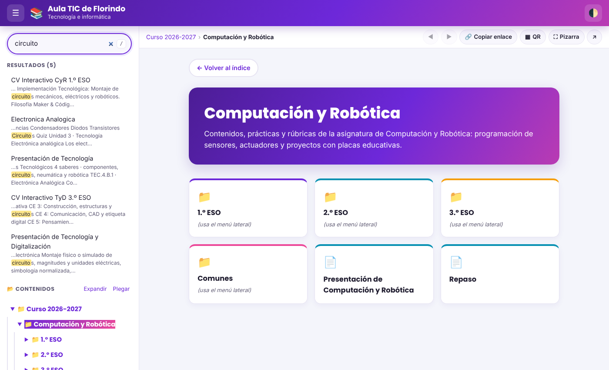
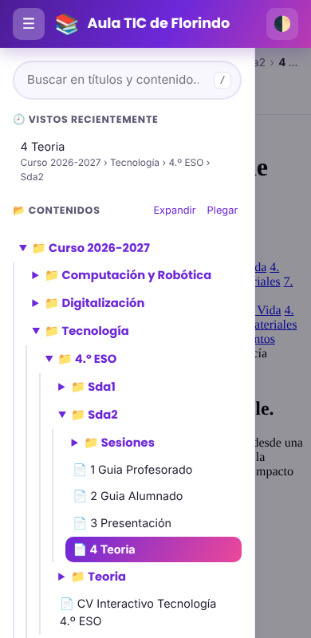

# Propuesta de mejora del Aula TIC

> Rama: `claude/blog-improvement-proposal-9o5ric`
>
> **No modifica nada existente.** Todo está en la carpeta `propuesta/`. El portal actual
> (`index.html`, `css/`, `js/`, `scripts/build-menu.mjs`, `.github/workflows/deploy.yml`)
> sigue igual y se despliega igual. Para adoptar cada mejora hay que copiarla a su sitio
> (ver [Cómo adoptarlo](#cómo-adoptarlo)).

## Contenido de la carpeta

| Fichero | Qué es |
|---|---|
| `propuesta/README.md` | Este documento: diagnóstico y propuestas. |
| `propuesta/workflows/deploy.yml` | Workflow de despliegue v2. **Inactivo**: GitHub solo ejecuta los de `.github/workflows/`. |
| `propuesta/scripts/build-site.mjs` | Build v2: reutiliza `build-menu.mjs` y añade lista blanca de publicación, índice de búsqueda, `sitemap.xml`, `404.html`, `version.json` y comprobación de enlaces rotos. |
| `propuesta/index.html`, `css/app.css`, `js/app.js` | Prototipo funcional de la interfaz v2. Usa el mismo `menu.json` y el mismo formato de enlaces (`#content/...`), así que los enlaces ya compartidos siguen funcionando. |

### Capturas del prototipo

| Escritorio (búsqueda en el texto, migas, barra de herramientas) | Móvil (menú como cajón) |
|---|---|
|  |  |

### Probarlo en local

```bash
node propuesta/scripts/build-site.mjs      # genera _site/ (sin tocar nada fuera de _site/)
cd _site && python3 -m http.server 8000
# Portal actual:   http://localhost:8000/
# Portal v2:       http://localhost:8000/propuesta/
```

> Nota: el build reutiliza `scripts/build-menu.mjs`, que reescribe `menu.json` y los
> `_pagina.html` en la raíz del repo, igual que hoy. Después de probar, si no quieres
> ese cambio, haz `git checkout -- menu.json content/`.

---

## 1. Despliegue (GitHub Actions / Pages)

### Diagnóstico

| # | Situación actual | Impacto |
|---|---|---|
| D1 | El workflow sube **todo el repositorio** (`path: .`). | `private_content/` (alimentación, horario 25-26), `prompts/`, `scripts/` y `abrir-portal.cmd` son **accesibles públicamente** por URL aunque no salgan en el menú. Lo mismo `steam-4.0/`, que se oculta del menú pero sí se publica. |
| D2 | `menu.json` y `content/curso2026-2027/_pagina.html` están en `.gitignore` **pero también versionados** (se subieron antes de ignorarlos). | Cada build local los marca como modificados y es fácil subir versiones obsoletas o tener conflictos. |
| D3 | Solo se ejecuta en `push` a `main`. | No hay forma de validar un cambio antes de publicarlo, ni de redesplegar sin hacer un commit. |
| D4 | No hay ninguna comprobación. | Un enlace roto, un archivo renombrado o un `meta.json` mal escrito llegan directamente a la web. |
| D5 | Cualquier commit (incluidos los de `prompts/` o un README) dispara un despliegue completo. | Despliegues innecesarios. |
| D6 | No existe `404.html`, `sitemap.xml` ni marca de versión. | Un enlace antiguo muestra la página genérica de GitHub; no se sabe qué versión está publicada. |

### Propuestas (implementadas en `propuesta/`)

1. **Publicar solo una lista blanca** (`index.html`, `bienvenida.html`, `menu.json`, `css/`, `js/`, `assets/`, `content/`) copiada a `_site/`. Lo privado deja de publicarse aunque esté en el repo. El workflow incluye además una comprobación explícita que falla si `private_content/` o `prompts/` aparecen en `_site/`. *(D1)*
2. **Validar en las Pull Requests**: el workflow v2 construye y valida en cada PR, pero solo despliega desde `main`. *(D3)*
3. **`workflow_dispatch`**: botón "Run workflow" para redesplegar sin commit. *(D3)*
4. **Comprobación de enlaces internos** (`--strict`): el build falla si una página enlaza a un `.html`, PDF o imagen que no existe. Hoy pasa limpio. *(D4)*
5. **`paths-ignore`**: no se redespliega por cambios en `prompts/`, `private_content/` o `.md`. *(D5)*
6. **`404.html`, `sitemap.xml`, `version.json` y `.nojekyll`** generados en el build; resumen del build (páginas, tamaño) en la pestaña *Actions*. *(D6)*

### Propuestas adicionales (no implementadas, para decidir)

- **D2**: dejar de versionar los ficheros generados: `git rm --cached menu.json content/**/_pagina.html`. El build de CI ya los regenera.
- **`private_content/`**: si es realmente privado, lo más seguro es **sacarlo del repositorio** (si el repo es público, también se ve en GitHub, no solo en la web). Alternativas: repo privado aparte, o Google Drive/Moodle.
- **Previsualización de PRs**: publicar cada PR en una URL temporal (p. ej. Cloudflare Pages o Netlify, gratuitos) para revisar antes de fusionar.
- **Optimizar PDFs/imágenes** en el build (el sitio pesa ~10 MB y `electronica-analogica.html` sola ocupa 2,1 MB, porque lleva 50 imágenes incrustadas en base64).

---

## 2. Estilo

### Diagnóstico

| # | Situación actual |
|---|---|
| E1 | **63 de 72 páginas** cargan Tailwind desde `cdn.tailwindcss.com` (el "Play CDN"). Tailwind avisa de que **no es para producción**: compila los estilos en el navegador de cada alumno en cada carga, es más lento y, si el CDN falla o la red del centro lo bloquea, la página sale **sin estilos** (comprobado en las pruebas de esta propuesta). El repo ya tiene `assets/tailwind.global.js` descargado, pero ninguna página lo usa. |
| E2 | Librerías sin versión fija: `unpkg.com/lucide@latest` (5 páginas) y `cdn.jsdelivr.net/npm/chart.js` (11). Una versión nueva incompatible puede romper páginas sin que nadie haya tocado nada. |
| E3 | Tres estilos distintos conviven: `css/style.css` (violeta, Poppins/Inter), `bienvenida.html` (azul, system-ui) y cada página generada con su propio Tailwind. `css/leccion.css` existe pero ninguna página lo usa. |
| E4 | Sin tema oscuro; la cabecera ocupa mucho alto, lo que resta espacio a la pizarra digital. |
| E5 | 5 páginas `moodle.html` / `sesion-1-…` no tienen `<title>`. |

### Propuestas

- **E1 → Tailwind compilado en el build** (recomendado): el build ejecuta Tailwind CLI sobre `content/**/*.html` y genera un único `assets/tailwind.css`; las páginas lo enlazan con `<link>`. Más rápido, funciona sin conexión al CDN y elimina el aviso de la consola. Para no tocar los originales se puede hacer en el build (reescribiendo la etiqueta solo en la copia de `_site/`), migrando poco a poco. *Ojo*: Tailwind 3 → 4 cambia algunas clases; conviene revisar las páginas una a una.
  Alternativa mínima: sustituir el Play CDN por el `assets/tailwind.global.js` local (mismo funcionamiento, sin depender del CDN externo).
- **E2 → fijar versiones** (`chart.js@4.4.x`, `lucide@0.4xx`) en los prompts de `prompts/` para que las páginas nuevas ya salgan bien.
- **E3 → un único "sistema de diseño"**: variables de color y tipografía compartidas (las del portal: violeta/cian/rosa, Poppins + Inter) y que `bienvenida.html` y las portadas generadas las usen. Añadir esas variables a los prompts de generación de contenido.
- **E4 → implementado en el prototipo**: tema oscuro (automático según el sistema y con botón), cabecera compacta de 60 px y foco visible para teclado.
- **E5 → título obligatorio**: el build puede avisar de páginas sin `<title>` (se usa para buscador, pestaña y QR).

---

## 3. Funcionalidad

Implementado en el prototipo `propuesta/index.html`:

| Funcionalidad | Para qué |
|---|---|
| 🔎 **Búsqueda en el texto** de las páginas (no solo en el nombre), con fragmento resaltado | Encontrar "circuitos" o "netiqueta" aunque no esté en el nombre del archivo. Usa `search-index.json` que genera el build; si no existe, busca solo por nombre. |
| ⌨️ Atajos: `/` para buscar, `Esc` para limpiar, `Alt+←/→` anterior/siguiente | Uso rápido desde el ordenador del aula. |
| 🧭 **Migas de pan** y título de pestaña con el nombre de la página | Saber dónde estás; pestañas e historial con nombres útiles. |
| ◀ ▶ **Anterior / Siguiente** dentro de la misma carpeta | Recorrer sesiones o presentaciones de una SdA en orden. |
| ▦ **Código QR** del recurso actual | Proyectarlo para que el alumnado abra la página en su dispositivo al instante. |
| 🔗 **Copiar enlace** | Pegarlo en Moodle, Classroom o correo. |
| ⛶ **Modo pizarra** | Pantalla completa sin cabecera ni menú. |
| 🕘 **Vistos recientemente** (en el navegador) | Volver rápido a lo que se usa cada día. |
| ☰ **Menú plegable** en escritorio y **cajón lateral** en móvil | Más espacio para el contenido; en móvil el menú ya no ocupa el 42 % de la pantalla. |
| Expandir / Plegar todo | Navegar árboles grandes. |
| Sincronización con el iframe | Si se navega desde una portada (tarjetas), la URL, las migas y el menú se actualizan. |
| "Actualizado: fecha · N páginas" | Saber qué versión está publicada (lee `version.json`). |
| Accesibilidad | Enlace "Saltar al contenido", `aria-current`, `aria-expanded`, respeta `prefers-reduced-motion`. |

Ideas para siguientes fases (no implementadas):

- **Etiquetas en `meta.json`** (`"tags": ["arduino", "evaluación"]`) y filtros por curso/asignatura.
- **Marcar "Nuevo"** las páginas añadidas en los últimos 7 días (fecha del último commit en el build).
- **PWA / modo sin conexión** (service worker) para cuando falle la red del centro.
- **Portadas más ricas**: que las tarjetas de carpeta sin portada enlacen al primer contenido en lugar de "(usa el menú lateral)", y mostrar la descripción de cada `meta.json`.
- **Orden manual** en `meta.json` (`"order": [...]`) en lugar de solo alfabético.

---

## Cómo adoptarlo

Por fases, cada una reversible:

1. **Probar** el prototipo en local (ver arriba) o, tras fusionar la rama, en `https://<usuario>.github.io/<repo>/propuesta/` (el despliegue actual publica todo el repo, así que la carpeta será accesible sin cambiar nada más).
2. **Despliegue v2**: copiar `propuesta/workflows/deploy.yml` a `.github/workflows/deploy.yml` y añadir `_site/` a `.gitignore`. A partir de ahí `private_content/` y `prompts/` dejan de publicarse.
3. **Interfaz v2**: cuando guste, mover `propuesta/index.html`, `css/app.css` y `js/app.js` a la raíz y quitar `data-base="../"` (y cambiar `../bienvenida.html` por `bienvenida.html`). Los enlaces `#content/...` antiguos siguen funcionando.
4. **Estilo de contenidos**: Tailwind compilado y versiones fijadas, empezando por las páginas nuevas (actualizando los prompts).
5. **Limpieza**: `git rm --cached menu.json content/**/_pagina.html` y decidir qué hacer con `private_content/`.
